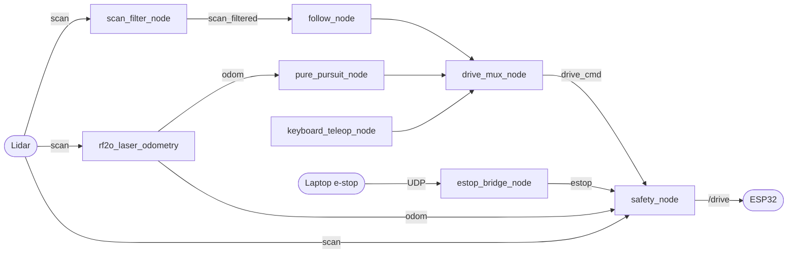

# Traxxas RC car autonomy stack (ROS 2)

A 1/10 Traxxas Slash 2WD that maps a track with its lidar, then races it with pure
pursuit. The car has no wheel encoders: one Hokuyo lidar provides the scan, the
odometry and the map.



Topics live under `/rc_car`; only `/drive` is absolute. In simulation, `f1tenth_gym`
stands in for the lidar, the odometry and the ESP32.

## Hardware

- **Chassis**: Traxxas Slash 2WD, stock XL-5 ESC and steering servo
- **Lidar**: Hokuyo UST-10LX, over Ethernet
- **Computer**: Jetson Orin Nano, Ubuntu 22.04, ROS 2 Humble
- **Actuation**: ESP32-S3 on USB. It subscribes to `/drive` over micro-ROS and
  outputs PWM. Its firmware is a separate project, not in this repository.

## Packages

| Package | What it does |
|---|---|
| `rc_perception` | `scan_filter_node` cleans the scan for `follow_node`: a beam with no echo (NaN) becomes max range, and every range is clamped to the sensor's limits |
| `rc_control` | Three drivers: `follow_node` (wall and gap following), `pure_pursuit_node`, `keyboard_teleop_node`. `drive_mux_node` picks one |
| `rc_safety` | `safety_node` is the only publisher of `/drive`. It brakes before the car's body, following its steering, would hit something; when the scan, odometry or drive command stops arriving for 0.5 s; and on the e-stop |
| `rc_localization` | Particle filter on a saved map (GPU ray casting with RangeLibc), and `slam_toolbox` to build the map |
| `rc_monitor` | `jetson_monitor_node`: CPU, GPU, temperature, power, WiFi and the scan and odometry rates as OK/WARN/ERROR on `/diagnostics`, which Foxglove's Diagnostics panel shows |
| `rc_bringup` | Launch files and per-car parameters |
| `rc_description`, `rc_maps`, `rc_msgs`, `rc_sim` | URDF, saved tracks, messages, simulator launch |

## Install

From the workspace root, on ROS 2 Humble with `ros-dev-tools`:

```bash
sudo apt install tmux iw python3-psutil python3-transforms3d \
    ros-humble-{slam-toolbox,nav2-map-server,nav2-lifecycle-manager,foxglove-bridge} \
    ros-humble-{ackermann-msgs,diagnostic-updater,xacro,joint-state-publisher}

# third-party sources at pinned commits, kept out of git, and this stack's fixes
vcs import --recursive src < third_party.repos
patch -p1 -d src/urg_node2 < patches/urg_node2-no-echo-nan.patch
patch -p1 -d src/rf2o_laser_odometry < patches/rf2o-silent-on-failure.patch
patch -p1 -d src/f1tenth_simulator < patches/f1tenth_simulator-colcon-and-lidar-rate.patch

source /opt/ros/humble/setup.bash
colcon build
```

Each patch starts with what it fixes and why:

- **urg_node2**: "no echo" is NaN, not a 65.5 m range. Unpatched, the odometry
  fails on about 30 % of outdoor scans.
- **rf2o**: a failed estimate publishes nothing, so `safety_node` sees the odometry
  stop and brakes, instead of trusting a repeated pose.
- **f1tenth simulator**: builds with colcon, and scans at the lidar's 40 Hz, not 250 Hz.

The simulator also needs these Python packages. The pip ones are pinned, so pip
leaves ROS's numpy alone:

```bash
sudo apt install python3-scipy python3-cloudpickle
pip install --user "numba==0.57.1" "pyglet<1.5"
```

The real car needs two more things:

- **micro-ROS agent**, built in its own workspace (`~/microros_ws`) with
  [micro_ros_setup](https://github.com/micro-ROS/micro_ros_setup).
- **RangeLibc with CUDA**, for the particle filter in `mode:=racing`:

  ```bash
  pip install --user "Cython<3"
  sudo apt install cuda-nvcc-12-6      # the Jetson image ships CUDA without nvcc
  cd src/rc_localization/vendor/range_libc/pywrapper
  env -u VIRTUAL_ENV WITH_CUDA=ON /usr/bin/python3 -m pip install --user --no-build-isolation .
  ```

  The flags are needed: its `setup.py` imports Cython and numpy, which an isolated
  build does not have, and ROS nodes run on `/usr/bin/python3`, not in a virtualenv.

## Run

```bash
source /opt/ros/humble/setup.bash
source ~/microros_ws/install/setup.bash      # car only
source install/setup.bash

ros2 launch rc_bringup car.launch.py mode:=mapping
ros2 launch rc_bringup car.launch.py mode:=racing map:=<track>
ros2 launch rc_bringup car.launch.py mode:=teleop
ros2 launch rc_bringup sim.launch.py mode:=racing        # the same modes; spielberg track
```

| `mode` | Who drives | Localization |
|---|---|---|
| `mapping` | `follow_node`: follows a wall, or the widest gap when blocked | `slam_toolbox` builds the map |
| `racing` | `pure_pursuit_node` on the track's `racingline.csv` | Particle filter on the saved map (sim: ground truth) |
| `teleop` | You: `scripts/keyboard_teleop.sh` in a terminal of its own | None |

- **Nothing moves until the [remote e-stop](#remote-e-stop) is reset.** The
  time-to-collision brake stays on in every mode, teleop included.
- **Keyboard**: `w`/`s` throttle, `a`/`d` steering, `space` stop. Let go of a key
  and the throttle cuts.
- **Foxglove**: connect to `ws://<jetson>:8765`. It is read-only: it shows
  everything, but cannot publish, set parameters or call services. A layout for
  mapping runs is in `src/rc_bringup/foxglove/follow.json`.
- **On the car**, use `scripts/start_car_session.sh mapping|racing <track>` or
  `scripts/start_car_session.sh teleop`. It is the same launch inside tmux, so it
  survives a dropped SSH link. It records a bag into `bags/`, and in teleop it
  opens the keyboard in a `drive` window.
- **Replay a bag**: `scripts/replay_bag.sh bags/<stamp>`, Foxglove on port 8766.
  It runs on its own DDS domain, so replayed commands cannot reach the car.
- **Tune live**: `ros2 param set /rc_car/follow_node wall_side right`. Defaults are
  in each package's `config/basic.yaml`, per-car values in `rc_bringup/config/`.
  The safety parameters are read-only while the car runs: edit them and relaunch.

## Remote e-stop

The car drives only while a laptop keeps telling it to. The stack starts
**stopped**, in simulation too.

```bash
# once, on the car: create the shared token
(umask 077; mkdir -p ~/.config/rc_car && python3 -c 'import secrets; print(secrets.token_urlsafe(24))' > ~/.config/rc_car/estop_token)

# once, on the laptop (plain Python 3, no ROS): copy the script and the token
scp <user>@<jetson>:<workspace>/src/rc_safety/scripts/estop_remote.py .
mkdir -p -m 700 ~/.config/rc_car
scp <user>@<jetson>:.config/rc_car/estop_token ~/.config/rc_car/ && chmod 600 ~/.config/rc_car/estop_token

# every session
python3 estop_remote.py --host <jetson>      # 127.0.0.1 for the simulator
```

Keys: `r` allows driving, `space` stops, `q` stops and quits.

- The car stops by itself after 0.5 s without a heartbeat (Ctrl-C, closed lid,
  lost WiFi) and stays stopped until `r`.
- Only a remote that sends the car's token can reset it. Without a token file
  the bridge exits and the car stays stopped.
- `--host` defaults to `10.42.0.1`, the car's own WiFi hotspot.

## From mapping to racing

1. `scripts/start_car_session.sh mapping <track>` and drive one lap plus a few
   metres. Stop there: slam_toolbox only removes its drift when it recognises
   the start again, and further laps just draw rotated copies of the track.
2. During that lap, record the line to race:
   `python3 scripts/record_waypoints.py --output src/rc_maps/tracks/<track>/racingline.csv`,
   Ctrl+C back at the start. For a minimum-curvature line instead, run
   `notebook/map_pipeline.ipynb` on the saved map afterwards.
3. Press Enter in the tmux `map` window. It saves the map and rebuilds `rc_maps`.
4. `scripts/start_car_session.sh racing <track>`

## The `/drive` contract

`ackermann_msgs/AckermannDriveStamped` in SI units, from every driver to the actuator:

| Field | Unit | Sign |
|---|---|---|
| `drive.speed` | m/s | positive forward |
| `drive.steering_angle` | rad | positive left (REP 103) |

- Nothing in the stack scales or clamps. `safety_node` relays the command
  untouched or replaces it with a full stop, 0.0 in both fields.
- Limits belong to whatever is on the other end: the firmware on the car, the
  vehicle model in `f1tenth_gym`. A different chassis is a firmware change.
- `max_speed` in `rc_control` is a planning cap, not a guard.

## Status

- **Speed is not calibrated.** The firmware's m/s to PWM mapping and the car's
  `ttc_threshold` are estimates, not yet measured on the ground.
- **Lidar-only odometry drifts.** The outdoor track `outdoor_test_1` does not
  close its loop and has no raceline. `spielberg` is the simulator's track.

## Tests

```bash
colcon test && colcon test-result --verbose
```

134 tests, `ament_flake8` included. Third-party packages are skipped, see
`colcon_defaults.yaml`.

## License

MIT, see `LICENSE`, except for these third-party parts:

| Path | License | From |
|---|---|---|
| `src/rc_localization/vendor/range_libc/` | Apache-2.0, with BSD-3-Clause and Zlib files | [RangeLibc](https://github.com/f1tenth/range_libc), Corey H. Walsh |
| `src/rc_maps/tracks/spielberg/` | GPL-3.0; track data © [OpenStreetMap](https://www.openstreetmap.org/copyright) contributors | [f1tenth_racetracks](https://github.com/f1tenth/f1tenth_racetracks) |
| `patches/` | The patched project's own: Apache-2.0, GPL-3.0 or MIT | See each patch |

- Full license texts are in `LICENSES/`.
- The particle filter is adapted from Corey Walsh's
  [particle_filter](https://github.com/mit-racecar/particle_filter), also MIT.
- Dependencies you install yourself keep their own licenses. ROS 2 is Apache-2.0.
  rf2o (GPL-3.0) and slam_toolbox (LGPL) run as separate processes, so this code
  stays MIT.
